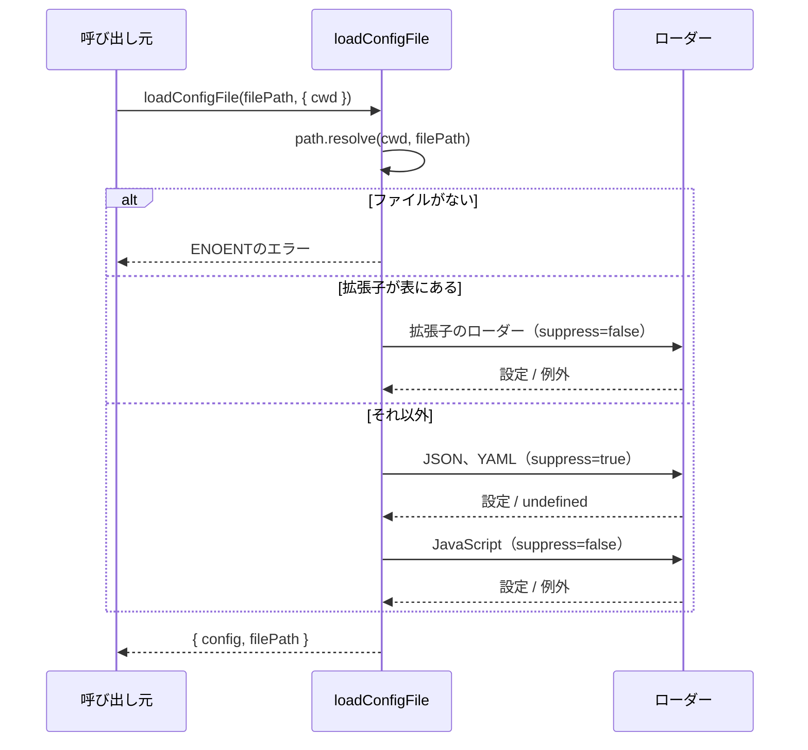

# 指定した設定ファイルの読み込みの設計

[English](design.md)

## このドキュメントについて

[指定した設定ファイルの読み込みのRequirements](requirements.ja.md)を、`loadConfigFile`でどう実現しているかを説明します。
親Productは[rc-config-loader](../../product.ja.md)です。

### 対象読者

`loadConfigFile`を変更する人とエージェント。

### 前提知識

[設定ファイルの形式](../config-formats/requirements.ja.md)。形式ごとのローダーは、`suppress`が`false`なら読めないときにエラーを投げ、`true`なら`undefined`を返します。

### このドキュメントで扱わないこと

形式ごとのローダーの実装は、設定ファイルの形式の機能の設計で扱います。

## 実装方針

`loadConfigFile`は`src/rc-config-loader.ts`にあり、探索の`findConfig`を使わずに1つのファイルを読みます。
形式ごとのローダーと、拡張子からローダーを引く表`defaultLoaderByExt`は`rcFile`と共有します。

1. `path.resolve(cwd, filePath)`で絶対パスにします。`cwd`の既定値は`process.cwd()`です。
2. `fs.existsSync`でファイルがなければ、`code = "ENOENT"`と`path`を付けたエラーを投げます。呼び出し側がファイルの有無を`code`で判定できるように、Node.jsのファイル操作のエラーと同じ`code`にしています。
3. `path.extname`の拡張子が`defaultLoaderByExt`にあれば、そのローダーを`suppress = false`で呼び、結果を返します。
4. 拡張子が表にないか、拡張子がない場合は、JSONとYAMLのローダーを`suppress = true`で順に呼び、`undefined`以外を返した最初の結果を返します。
5. どちらでも読めなければ、JavaScriptのローダーを`suppress = false`で呼びます。読めなければ、そのエラーが投げられます。

最後のJavaScriptだけを`suppress = false`で呼ぶため、どの形式でも読めないときはJavaScriptのエラーが利用者に届きます。

`rcFile`の`configFileName`を使わずに別の関数にしたのは、`rcFile`の探索と拡張子の補完を変えずに、探索しない読み方を足すためです。`rcFile`の振る舞いを変えないので、マイナーリリースとして公開しました（[#33](https://github.com/azu/rc-config-loader/pull/33)）。

## アーキテクチャ・シーケンス図



## データモデル・ER 図

`loadConfigFileOption`（`cwd`）を`src/types.ts`で定義しています。戻り値は`rcFile`と同じ`rcConfigResult`です。

## API・インターフェース

```ts
export function loadConfigFile<R extends {}>(
    filePath: string,
    opts?: loadConfigFileOption
): rcConfigResult<R>;
```

READMEの「Load exactly one config file」の節が利用者向けの説明です。

## 外部サービスとの連携方式

なし。

## データの取り扱い設計

読んだ設定は戻り値として返すだけで、キャッシュしません。

## 認証認可に関する特記事項

なし。ファイルの読み取り権限はNode.jsのプロセスに従います。

## セキュリティ上の留意事項

なし。JavaScriptを実行することの注意は[設定ファイルの形式](../config-formats/requirements.ja.md#セキュリティ上の留意事項)にあります。

## デプロイに関する特記事項

なし。

## 検討した代替手段

### `rcFile`にオプションを足す

`rcFile`に探索しないオプションを足す方法は、[#33](https://github.com/azu/rc-config-loader/pull/33)の提案では採らず、別の関数にしました。オプションを足す方法を比べた記録はありません。

## 未決事項

なし。
