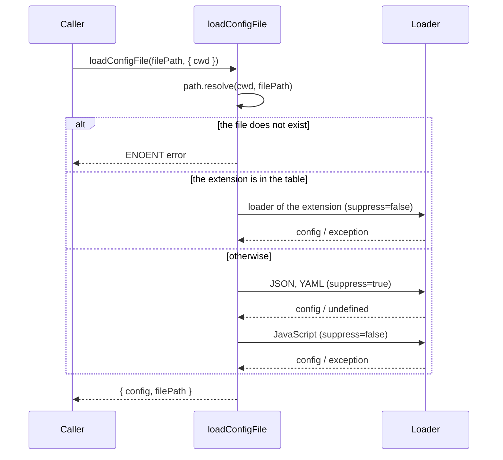

# Design of specified configuration file loading

[日本語](design.ja.md)

## About this document

This document describes how the [Requirements of specified configuration file loading](requirements.md) are implemented with `loadConfigFile`.
The parent Product is [rc-config-loader](../../product.md).

### Audience

People and agents who change `loadConfigFile`.

### Prerequisites

[Configuration file formats](../config-formats/requirements.md). The loader of each format throws an error when it cannot read the file if `suppress` is `false`, and returns `undefined` if `suppress` is `true`.

### Out of scope

The implementation of the loader of each format is described in the design of the configuration file formats feature.

## Implementation approach

`loadConfigFile` is in `src/rc-config-loader.ts`, and reads one file without using `findConfig` of the search.
The loaders of each format, and the table from extensions to loaders `defaultLoaderByExt`, are shared with `rcFile`.

1. The path is made absolute with `path.resolve(cwd, filePath)`. The default `cwd` is `process.cwd()`.
2. When `fs.existsSync` does not find the file, an error with `code = "ENOENT"` and `path` is thrown. The `code` is the same as file operation errors of Node.js, so that a caller can tell whether the file exists by `code`.
3. When the extension from `path.extname` is in `defaultLoaderByExt`, that loader is called with `suppress = false`, and its result is returned.
4. When the extension is not in the table, or there is no extension, the JSON and YAML loaders are called in order with `suppress = true`, and the first result other than `undefined` is returned.
5. When neither can read the file, the JavaScript loader is called with `suppress = false`. If it cannot read the file, its error is thrown.

Because only the last JavaScript loader is called with `suppress = false`, the JavaScript error reaches the user when no format can read the file.

It is a separate function instead of using `configFileName` of `rcFile`, so that loading without searching could be added without changing the search and extension completion of `rcFile`. Because `rcFile` keeps its behavior, it was published as a minor release ([#33](https://github.com/azu/rc-config-loader/pull/33)).

## Architecture and sequence diagrams



## Data model and ER diagram

`loadConfigFileOption` (`cwd`) is defined in `src/types.ts`. The return type is `rcConfigResult`, the same as `rcFile`.

## API and interfaces

```ts
export function loadConfigFile<R extends {}>(
    filePath: string,
    opts?: loadConfigFileOption
): rcConfigResult<R>;
```

The "Load exactly one config file" section of the README is the explanation for users.

## External service integration

None.

## Data handling

The configuration that is read is only returned, and is not cached.

## Authentication and authorization

None. Permission to read files follows the Node.js process.

## Security considerations

None. The note about running JavaScript is in [Configuration file formats](../config-formats/requirements.md#security-considerations).

## Deployment notes

None.

## Alternatives considered

### Adding an option to `rcFile`

The proposal in [#33](https://github.com/azu/rc-config-loader/pull/33) did not add an option to `rcFile` to skip the search, and made a separate function instead. No comparison with adding an option is recorded.

## Open questions

None.
