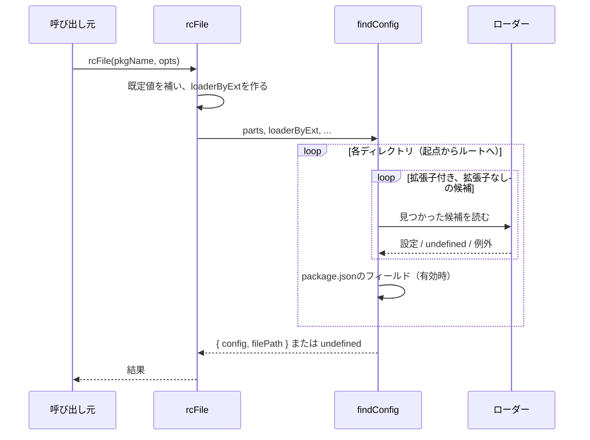

# 設定ファイルの探索の設計

[English](design.md)

## このドキュメントについて

[設定ファイルの探索のRequirements](requirements.ja.md)を、`rcFile`と`findConfig`でどう実現しているかを説明します。
親Productは[rc-config-loader](../../product.ja.md)です。

### 対象読者

`rcFile`の探索を変更する人とエージェント。

### 前提知識

[設定ファイルの形式](../config-formats/requirements.ja.md)。形式ごとのローダーは、`suppress`が`false`なら読めないときにエラーを投げ、`true`なら`undefined`を返します。

### このドキュメントで扱わないこと

形式ごとのローダーの実装は、設定ファイルの形式の機能の設計で扱います。

## 実装方針

`rcFile`はオプションに既定値を補い、探索に使う表を作ってから、再帰関数`findConfig`に探索を任せます。
処理はすべて`src/rc-config-loader.ts`にあり、同期のファイル操作だけを使います。

### 1. オプションを決める

削除した`defaultExtension`がオプションにあれば、`defaultExtension option is removed. Use extensions option instead.`のエラーを投げます。値が`undefined`でも、キーがあれば投げます。
`configFileName`、`cwd`、`packageJSON`を、省略されていれば既定値で補います。
`packageJSON`がオブジェクトなら`fieldName`を、そうでなければ`pkgName`をフィールド名にします。

### 2. 探す拡張子を決める

`resolveAllowedExtensions`で、探してよい拡張子の配列（`allowedExtensions`）を決めます。
`extensions`を省略したときは探索の既定値`defaultSearchExtensions`（`[".json", ".yaml", ".yml", ".js", ".ts"]`）を、指定したときはその配列を返します。
指定した配列が空なら`extensions should be a non-empty array.`、表にない拡張子を含むなら`<拡張子> is not supported.`のエラーを投げます。

### 3. 拡張子のない候補のローダーを決める

`selectLoadersForNoExtension`が、`allowedExtensions`の順に、`.json`ならJSON、`.yaml`か`.yml`ならYAML、`.js`ならJavaScriptのローダーを集めます。
ほかの拡張子はローダーを足しません。拡張子のないファイルは、Node.jsの型の除去の対象にならないためです。
同じローダーは2回入れません。`.yaml`と`.yml`の両方があってもYAMLは1回だけ試し、JavaScriptのファイルを2回実行しません。
集めたローダーが1つならローダー1つ、それ以外ならローダーの配列を`loadersByOrder`にします。

探索の表`loaderByExt`は、`allowedExtensions`の順に各拡張子のローダーを入れ、最後に空文字列の拡張子として`loadersByOrder`を加えたものです。
集めたローダーが0個なら、空文字列の拡張子は加えません。

### 4. ディレクトリごとに候補を確かめる

`cwd`を`path.resolve`で絶対パスにし、区切り文字で分けた配列`parts`にします。
`findConfig`は`loaderByExt`のキーの順に、`parts`のディレクトリへ`configFileName + 拡張子`を`path.resolve`で結合した場所を確かめます。
キーの順は表を作った順です。`extensions`を省略したときは`.json`、`.yaml`、`.yml`、`.js`、`.ts`、空文字列です。
`path.resolve`で結合するため、`configFileName`が絶対パスならディレクトリは無視されます。

ファイルが`fs.existsSync`で見つかったら、次のように読みます。

- ローダーが1つ（拡張子付きの候補、または拡張子のない候補で試す形式が1つ）なら、`suppress = false`で読みます。読めなければエラーが投げられます。
- ローダーが配列なら、順に`suppress = true`で読み、最初に値を返したローダーの結果を使います。どれも`undefined`を返したら、この候補を飛ばします。

どちらの場合も、読んだ値が偽（falsy）なら次の候補へ進みます。

ローダーが1つの候補を2回読まないようにしています。以前は1つのローダーを配列として扱った結果、同じファイルを2回実行していました。設定ファイルに副作用があると問題になるため直しました（[#4](https://github.com/azu/rc-config-loader/pull/4)）。

### 5. package.jsonを確かめる

候補がどれも見つからず`packageJSON`が有効なら、同じディレクトリの`package.json`を`JSON5.parse`で読み、フィールドの値が真（truthy）ならそれを返します。

### 6. 親へ移る

`parts`の末尾を取り除いて`findConfig`を呼び直します。
`parts`が空になったら`undefined`を返します。

## アーキテクチャ・シーケンス図



## データモデル・ER 図

`rcConfigLoaderOption`（`packageJSON`、`configFileName`、`cwd`、`extensions`）と、戻り値の`rcConfigResult`（`config`、`filePath`）を`src/types.ts`で定義しています。

## API・インターフェース

```ts
export function rcFile<R extends {}>(
    pkgName: string,
    opts?: rcConfigLoaderOption
): rcConfigResult<R> | undefined;
```

READMEのAPIの節が利用者向けの説明です。

## 外部サービスとの連携方式

なし。

## データの取り扱い設計

読んだ設定は戻り値として返すだけで、キャッシュしません。呼ぶたびにファイルを読み直します。

## 認証認可に関する特記事項

なし。ファイルの読み取り権限はNode.jsのプロセスに従います。

## セキュリティ上の留意事項

探索はファイルシステムのルートまで進み、途中で止める指定はありません。
`extensions`を指定すると、指定していない拡張子のファイルは`fs.existsSync`でも確かめないため、読まれることも実行されることもありません。

## デプロイに関する特記事項

なし。

## 検討した代替手段

親へさかのぼる探索、拡張子付きの候補を先に確かめること、`package.json`を同じディレクトリの候補の後に確かめることについて、検討した代替手段と判断理由の記録はなく、不明です。
探索は[zkochan/rcfile](https://github.com/zkochan/rcfile)を元にしています。

### `extensions`を省略したときはすべての拡張子を探す

TypeScriptとECMAScript Modulesの対応で探す拡張子が増えます。既存のツールが読める設定ファイルを減らさないよう、既定ですべての拡張子を探す案もありました。
拡張子が1つ増えるごとに、ディレクトリごとの存在確認が1回増え、見つからないときはルートまでさかのぼります。すべての拡張子を探すと、8階層下のディレクトリから設定のないまま探索したときの確認は150回で、v4の5つの拡張子では90回でした。
そのため既定値は`.json`、`.yaml`、`.yml`、`.js`、`.ts`に絞り、`.cjs`、`.mjs`、`.cts`、`.mts`は`extensions`で指定したときだけ探すことにしました（メジャーリリース）。
以前は`.cjs`を既定で探していたので、利用者が`.<name>rc.cjs`（たとえば`.secretlintrc.cjs`や`.textlintrc.cjs`）を使っているツールは、`extensions`に`.cjs`を足さないと見つけられなくなります。

### `defaultExtension`を残し、`extensions`と並べる

最初の案では、拡張子のない候補の形式を表す`defaultExtension`を残し、探す拡張子を別の`extensions`にしました。
2つのオプションの違いが分かりにくいため、`extensions`に一本化し、`defaultExtension`は削除しました（メジャーリリース）。
textlintとsecretlintは`defaultExtension`を指定していません。
指定されたときに黙って無視せず、エラーにして移行先を示します。

### 既定の優先順を`.cjs`、`.js`から始める

一本化の前は、拡張子付きの候補を`.cjs`、`.js`、`.json`、`.yaml`、`.yml`の順に確かめていました。
この順を既定値にすると、拡張子のない候補もJavaScriptから試すことになります。
そのため、拡張子のない候補の既定の順（JSON、YAML、JavaScript）に合わせ、`.json`から始まる順を既定値にしました。
同じディレクトリに`.foorc.cjs`と`.foorc.json`があると、以前は`.cjs`、今は`.json`が選ばれます。今は`.cjs`を既定では探しません。

## 未決事項

なし。振る舞いの未確認の項目は[Requirementsの未決事項](requirements.ja.md#未決事項)にあります。
