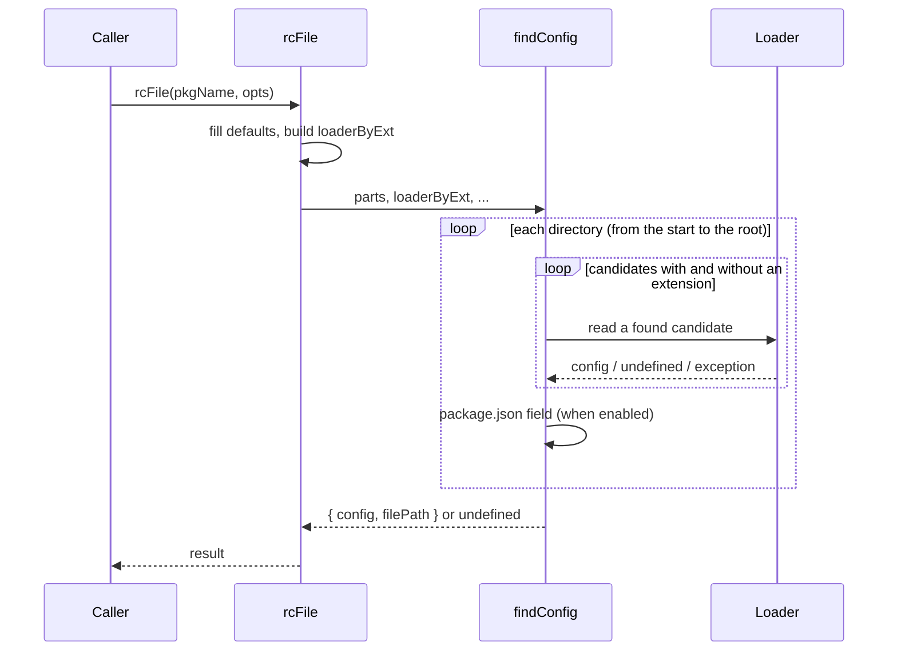

# Design of configuration search

[日本語](design.ja.md)

## About this document

This document describes how the [Requirements of configuration search](requirements.md) are implemented with `rcFile` and `findConfig`.
The parent Product is [rc-config-loader](../../product.md).

### Audience

People and agents who change the search of `rcFile`.

### Prerequisites

[Configuration file formats](../config-formats/requirements.md). The loader of each format throws an error when it cannot read the file if `suppress` is `false`, and returns `undefined` if `suppress` is `true`.

### Out of scope

The implementation of the loader of each format is described in the design of the configuration file formats feature.

## Implementation approach

`rcFile` fills in the default options, builds the tables used for the search, and leaves the search to the recursive function `findConfig`.
Everything is in `src/rc-config-loader.ts`, and only synchronous file operations are used.

### 1. Decide the options

When the options have the removed `defaultExtension`, `defaultExtension option is removed. Use extensions option instead.` is thrown. It is thrown when the key exists, even if the value is `undefined`.
`configFileName`, `cwd`, and `packageJSON` are filled in with the defaults when omitted.
When `packageJSON` is an object, its `fieldName` is the field name. Otherwise, `pkgName` is the field name.

### 2. Decide the extensions to search

`resolveAllowedExtensions` decides the array of extensions allowed to search (`allowedExtensions`).
When `extensions` is omitted, it returns the default of the search `defaultSearchExtensions` (`[".json", ".yaml", ".yml", ".js", ".ts"]`). When it is given, it returns that array.
When the given array is empty, it throws `extensions should be a non-empty array.`, and when it includes an extension not in the table, it throws `<extension> is not supported.`.

### 3. Decide the loaders for the candidate without an extension

`selectLoadersForNoExtension` collects, in the order of `allowedExtensions`, the JSON loader for `.json`, the YAML loader for `.yaml` or `.yml`, and the JavaScript loader for `.js`.
Other extensions do not add a loader, because a file without an extension is not a target of Node.js's type stripping.
The same loader is not added twice: YAML is tried once even when both `.yaml` and `.yml` are given, and a JavaScript file is not run twice.
When one loader is collected, `loadersByOrder` is that loader. Otherwise, it is the array of loaders.

The search table `loaderByExt` has the loader of each extension in the order of `allowedExtensions`, and `loadersByOrder` added last as the empty-string extension.
When no loader is collected, the empty-string extension is not added.

### 4. Check the candidates in each directory

`cwd` is made absolute with `path.resolve` and split by the separator into the array `parts`.
`findConfig` checks, in the order of the keys of `loaderByExt`, the location made by joining the directory of `parts` and `configFileName + extension` with `path.resolve`.
The order of the keys is the order in which the table was built. When `extensions` is omitted, it is `.json`, `.yaml`, `.yml`, `.js`, `.ts`, and the empty string.
Because the join uses `path.resolve`, the directory is ignored when `configFileName` is an absolute path.

When a file is found with `fs.existsSync`, it is read as follows.

- When there is one loader (a candidate with an extension, or one format to try for the candidate without an extension), it is read with `suppress = false`. An error is thrown if it cannot be read.
- When there is an array of loaders, they are tried in order with `suppress = true`, and the result of the first loader that returns a value is used. If all return `undefined`, the candidate is skipped.

In both cases, when the value read is falsy, the next candidate is checked.

A candidate with one loader is not read twice. Earlier, one loader was treated as an array, and the same file was run twice. This was fixed because it is a problem when a configuration file has side effects ([#4](https://github.com/azu/rc-config-loader/pull/4)).

### 5. Check package.json

When no candidate is found and `packageJSON` is enabled, the `package.json` of the same directory is read with `JSON5.parse`, and the value of the field is returned when it is truthy.

### 6. Move to the parent

The last element of `parts` is removed, and `findConfig` is called again.
When `parts` is empty, `undefined` is returned.

## Architecture and sequence diagrams



## Data model and ER diagram

`rcConfigLoaderOption` (`packageJSON`, `configFileName`, `cwd`, `extensions`) and the return type `rcConfigResult` (`config`, `filePath`) are defined in `src/types.ts`.

## API and interfaces

```ts
export function rcFile<R extends {}>(
    pkgName: string,
    opts?: rcConfigLoaderOption
): rcConfigResult<R> | undefined;
```

The API section of the README is the explanation for users.

## External service integration

None.

## Data handling

The configuration that is read is only returned, and is not cached. Files are read again on every call.

## Authentication and authorization

None. Permission to read files follows the Node.js process.

## Security considerations

The search goes up to the root of the file system, and there is no option to stop it on the way.
When `extensions` is given, files of the other extensions are not even checked with `fs.existsSync`, so they are neither read nor run.

## Deployment notes

None.

## Alternatives considered

No alternatives or reasons are recorded for searching up through the parents, for checking the candidates with an extension first, or for checking `package.json` after the candidates of the same directory, so they are unknown.
The search is based on [zkochan/rcfile](https://github.com/zkochan/rcfile).

### Searching every extension when `extensions` is omitted

Supporting TypeScript and ECMAScript Modules adds extensions to search. Searching every extension by default was an option, so that existing tools would not lose configuration files they can read.
Each extension adds one existence check per directory, and the search goes up to the root when nothing is found. With every extension, a search with no configuration from a directory 8 levels deep checked 150 paths, while 90 with the 5 extensions of v4.
So the default is limited to `.json`, `.yaml`, `.yml`, `.js`, and `.ts`, and `.cjs`, `.mjs`, `.cts`, and `.mts` are searched only when given in `extensions` (a major release).
`.cjs` was searched by default before, so a tool whose users have `.<name>rc.cjs` (for example `.secretlintrc.cjs` and `.textlintrc.cjs`) needs to add `.cjs` to `extensions` to keep finding it.

### Keeping `defaultExtension` next to `extensions`

The first plan kept `defaultExtension`, which tells the formats for the candidate without an extension, and added `extensions` for the extensions to search.
The difference between the two options was hard to understand, so they were consolidated into `extensions`, and `defaultExtension` was removed (a major release).
textlint and secretlint do not give `defaultExtension`.
When it is given, it is not silently ignored; an error shows what to use instead.

### Starting the default priority with `.cjs` and `.js`

Before the consolidation, the candidates with an extension were checked in the order `.cjs`, `.js`, `.json`, `.yaml`, `.yml`.
With that order as the default, the candidate without an extension would also be tried as JavaScript first.
So the default starts with `.json`, matching the default order for the candidate without an extension (JSON, YAML, JavaScript).
When a directory has both `.foorc.cjs` and `.foorc.json`, `.cjs` was chosen before, and `.json` is chosen now. `.cjs` is not searched by default now.

## Open questions

None. The unconfirmed items about the behavior are in the [open questions of the Requirements](requirements.md#open-questions).
