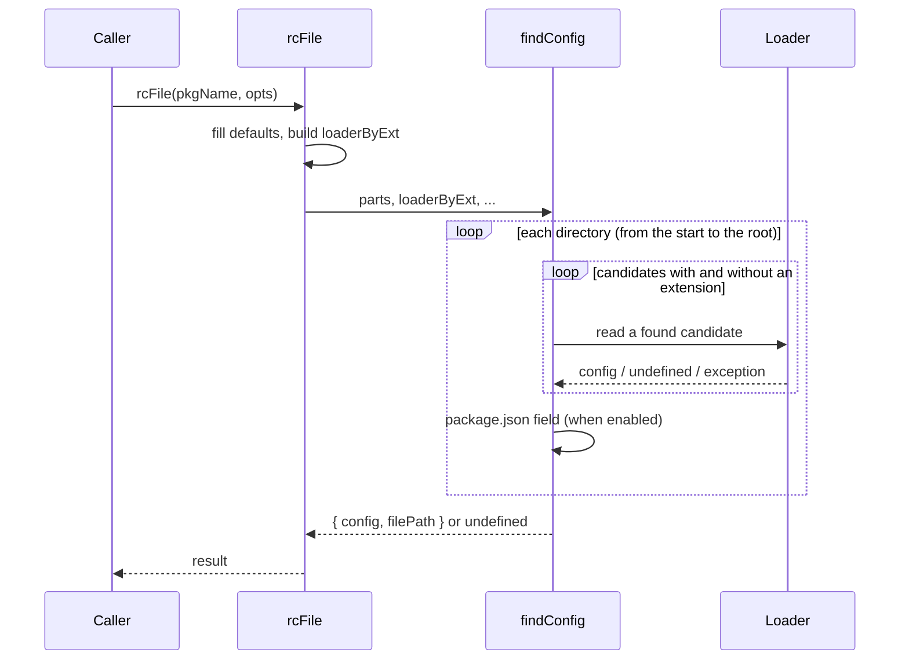

# Design of configuration search

[日本語](design.ja.md)

## About this document

This document describes how the [Requirements of configuration search](requirements.md) are implemented with `rcFile` and `findConfig`.
The parent Product is [rc-config-loader](../../product.md).

### Audience

People and agents who change the search of `rcFile`.

### Prerequisites

[Configuration file formats](../config-formats/requirements.md). The loader of each format throws an error when it cannot read the file if `suppress` is `false`, and returns `undefined` if `suppress` is `true`.

### Out of scope

The implementation of the loader of each format is described in the design of the configuration file formats feature.

## Implementation approach

`rcFile` fills in the default options, builds the tables used for the search, and leaves the search to the recursive function `findConfig`.
Everything is in `src/rc-config-loader.ts`, and only synchronous file operations are used.

### 1. Decide the options

`configFileName`, `defaultExtension`, `cwd`, and `packageJSON` are filled in with the defaults when omitted.
When `packageJSON` is an object, its `fieldName` is the field name. Otherwise, `pkgName` is the field name.

### 2. Decide the loaders for the candidate without an extension

Each extension of `defaultExtension` is turned into a loader with `selectLoader`.
`selectLoader` throws `<extension> is not supported.` for an extension that is not in the default `defaultExtension`.
When `defaultExtension` is an array, the result is an array of loaders (`loadersByOrder`). When it is one extension, the result is one loader.

The search table `loaderByExt` is the shared table from extensions to loaders, `defaultLoaderByExt`, with `loadersByOrder` added as the empty-string extension.

### 3. Check the candidates in each directory

`cwd` is made absolute with `path.resolve` and split by the separator into the array `parts`.
`findConfig` checks, in the order of the keys of `loaderByExt`, the location made by joining the directory of `parts` and `configFileName + extension` with `path.resolve`.
The order of the keys is the order in which the table was built: `.cjs`, `.js`, `.json`, `.yaml`, `.yml`, and the empty string.
Because the join uses `path.resolve`, the directory is ignored when `configFileName` is an absolute path.

When a file is found with `fs.existsSync`, it is read as follows.

- When there is one loader (a candidate with an extension, or one `defaultExtension`), it is read with `suppress = false`. An error is thrown if it cannot be read.
- When there is an array of loaders, they are tried in order with `suppress = true`, and the result of the first loader that returns a value is used. If all return `undefined`, the candidate is skipped.

In both cases, when the value read is falsy, the next candidate is checked.

A candidate with one loader is not read twice. Earlier, one loader was treated as an array, and the same file was run twice. This was fixed because it is a problem when a configuration file has side effects ([#4](https://github.com/azu/rc-config-loader/pull/4)).

### 4. Check package.json

When no candidate is found and `packageJSON` is enabled, the `package.json` of the same directory is read with `JSON5.parse`, and the value of the field is returned when it is truthy.

### 5. Move to the parent

The last element of `parts` is removed, and `findConfig` is called again.
When `parts` is empty, `undefined` is returned.

## Architecture and sequence diagrams



## Data model and ER diagram

`rcConfigLoaderOption` (`packageJSON`, `configFileName`, `defaultExtension`, `cwd`) and the return type `rcConfigResult` (`config`, `filePath`) are defined in `src/types.ts`.

## API and interfaces

```ts
export function rcFile<R extends {}>(
    pkgName: string,
    opts?: rcConfigLoaderOption
): rcConfigResult<R> | undefined;
```

The API section of the README is the explanation for users.

## External service integration

None.

## Data handling

The configuration that is read is only returned, and is not cached. Files are read again on every call.

## Authentication and authorization

None. Permission to read files follows the Node.js process.

## Security considerations

The search goes up to the root of the file system, and there is no option to stop it on the way.

## Deployment notes

None.

## Alternatives considered

No alternatives or reasons are recorded for searching up through the parents, for checking the candidates with an extension first, or for checking `package.json` after the candidates of the same directory, so they are unknown.
The search is based on [zkochan/rcfile](https://github.com/zkochan/rcfile).

## Open questions

None. The unconfirmed items about the behavior are in the [open questions of the Requirements](requirements.md#open-questions).
